# Wiring and pin numbers

One page per board: a pinout picture, then the same pins as a table. The pin numbers are taken from each sketch's `#define PIN_...` and motor-pin arrays. If a pin changes in a sketch, change it in [docs/make_pinouts.py](docs/make_pinouts.py) and run `python docs/make_pinouts.py` to redraw the pictures.

## Setup guides

- SimpleFC_Brushed: below
- SimpleTX + SimpleFC: [setup_guide_simpletx_simplefc.gif](docs/img/setup_guide_simpletx_simplefc.gif)
- Transmitter2: [setup_guide_transmitter2.gif](docs/img/setup_guide_transmitter2.gif)
- C3 Zero FC (FlightController): [setup_guide_c3zero_fc.gif](docs/img/setup_guide_c3zero_fc.gif)

Videos (vertical 1080x1920 MP4 for TikTok / Reels / Shorts, with the repo link at the bottom). Open one and press the download button:
[SimpleFC_Brushed](docs/video/setup_brushed.mp4) · [SimpleTX + SimpleFC](docs/video/setup_simpletx_simplefc.mp4) · [Transmitter2](docs/video/setup_transmitter2.mp4) · [C3 Zero FC](docs/video/setup_c3zero_fc.mp4)

### SimpleFC_Brushed

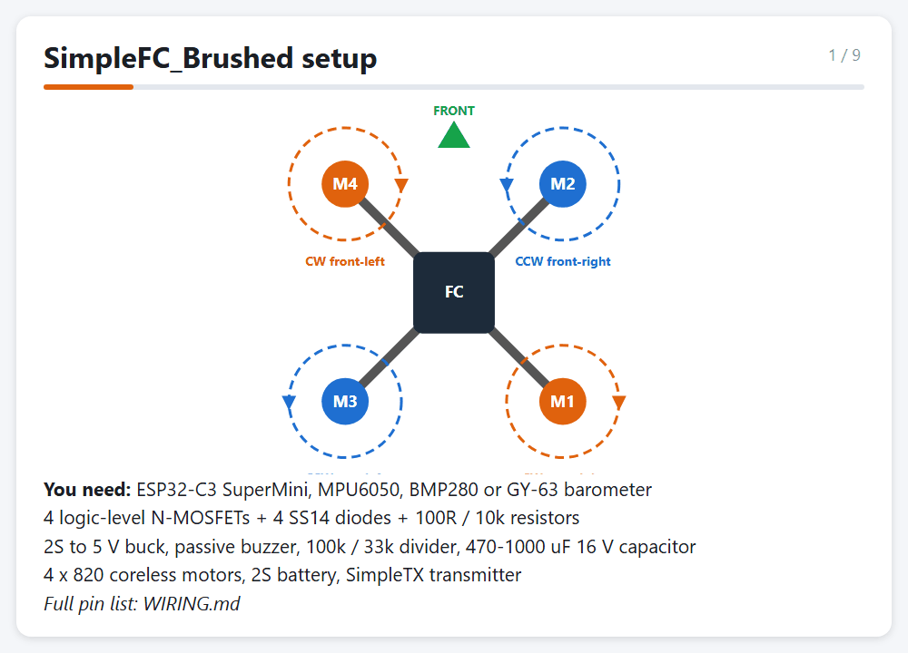

Made by [docs/make_setup_gif.py](docs/make_setup_gif.py) (needs `pip install pillow` and Edge or Chrome).

| Board | Sketch | Chip |
|---|---|---|
| [SimpleFC (brushless quad)](#simplefc--brushless-quad) | [SimpleFC/SimpleFC.ino](SimpleFC/SimpleFC.ino) | ESP32-C3 SuperMini |
| [SimpleFC_Brushed (2S micro)](#simplefc_brushed--2s-brushed-micro) | [SimpleFC_Brushed/SimpleFC_Brushed.ino](SimpleFC_Brushed/SimpleFC_Brushed.ino) | ESP32-C3 SuperMini |
| [SimpleTX (transmitter)](#simpletx--transmitter) | [SimpleTX/SimpleTX.ino](SimpleTX/SimpleTX.ino) | ESP32-C3 SuperMini |
| [Transmitter2](#transmitter2) | [Transmitter/Transmitter2/Transmitter2.ino](Transmitter/Transmitter2/Transmitter2.ino) | ESP32-C3 Zero |
| [FlightController (old quad)](#flightcontroller--old-c3-zero-quad) | [FlightController/FlightController.ino](FlightController/FlightController.ino) | ESP32-C3 Zero |
| [ESP32_NodeMCU_FC](#esp32_nodemcu_fc) | [ESP32_NodeMCU_FC/ESP32_NodeMCU_FC.ino](ESP32_NodeMCU_FC/ESP32_NodeMCU_FC.ino) | ESP32 DevKit / NodeMCU-32S |

## Motor order (all quads)

Betaflight order, seen from the top, front up, props in.

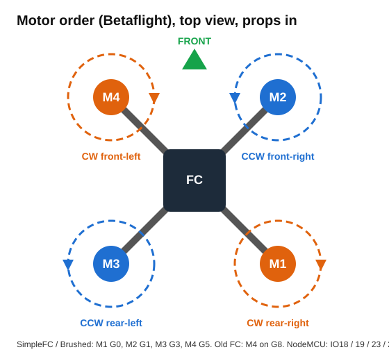

## Rules for every board

- **GND:** all grounds are joined: battery −, ESC or MOSFET grounds, sensors and the FC.
- **Battery divider:** pack+ → R1 → ADC pin → R2 → GND, with 100 nF from the ADC pin to GND. Keep the pin below about 2.5 V. Never connect a pack straight to a pin. Set `vRatio` = (R1 + R2) / R2.
- **I2C:** every I2C device shares the same two wires (SDA, SCL).
- **5 V pin:** feed it from a BEC or buck converter, not straight from the pack. A 7805 overheated and browned out the old quad in flight.
- **C3 GPIO2:** shorted to the crystal can on the original FC board, so the FC sketches leave it unused. It works on the TX boards.

---

## SimpleFC – brushless quad

**Setup guide:**

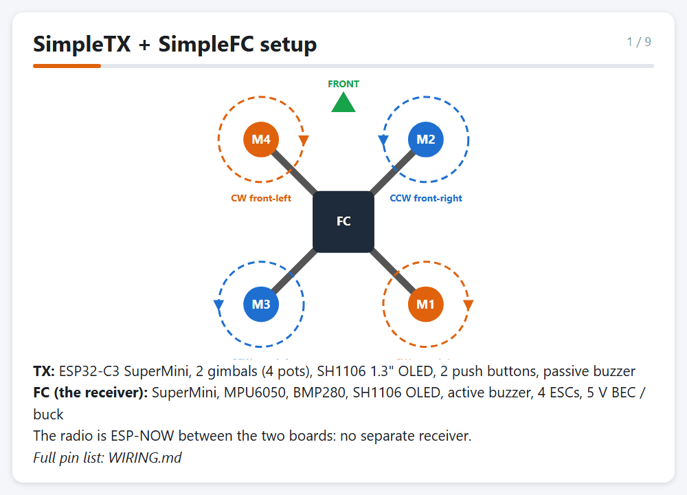

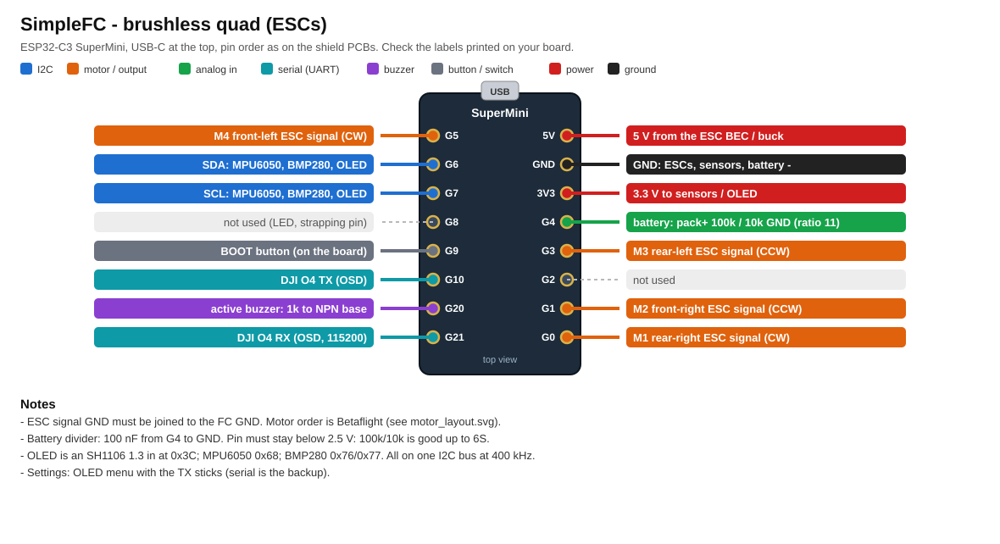

| Pin | Connects to |
|---|---|
| G0 | M1 rear-right ESC signal (CW) |
| G1 | M2 front-right ESC signal (CCW) |
| G3 | M3 rear-left ESC signal (CCW) |
| G5 | M4 front-left ESC signal (CW) |
| G6 / G7 | I2C SDA / SCL: MPU6050 (0x68), BMP280 (0x76/0x77), SH1106 OLED (0x3C) |
| G4 | Battery: pack+ 100k → G4 → 10k → GND (ratio 11) |
| G20 | Active buzzer: G20 → 1k → NPN base, buzzer between collector and +5 V |
| G21 → | DJI O4 air unit RX (OSD, MSP DisplayPort, 115200) |
| G10 ← | DJI O4 air unit TX |
| G9 | BOOT button on the board |
| G2, G8 | not used |

Shield PCB: [SimpleFC/pcb](SimpleFC/pcb). Parts placement:

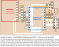

---

## SimpleFC_Brushed – 2S brushed micro

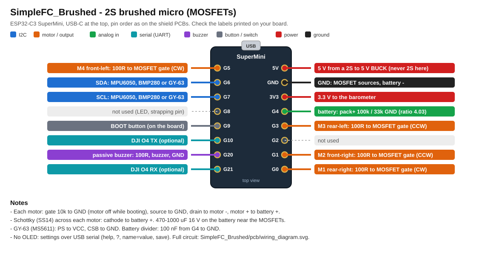

| Pin | Connects to |
|---|---|
| G0 | M1 rear-right: 100R → MOSFET gate (CW) |
| G1 | M2 front-right: 100R → MOSFET gate (CCW) |
| G3 | M3 rear-left: 100R → MOSFET gate (CCW) |
| G5 | M4 front-left: 100R → MOSFET gate (CW) |
| G6 / G7 | I2C SDA / SCL: MPU6050, BMP280 or GY-63 (MS5611) |
| G4 | Battery: pack+ 100k → G4 → 33k → GND (ratio 4.03 for 2S) |
| G20 | Passive buzzer: G20 → 100R → buzzer → GND |
| G21 / G10 | DJI O4 RX / TX (optional) |
| 5V | From a 2S → 5 V **buck**. Never put 2S on this pin. |

Each motor driver:
- Gate: 10k from the gate to GND, which keeps the motor off while the C3 boots.
- MOSFET: source to GND, drain to motor −, motor + to battery +.
- Diode: an SS14 Schottky across each motor, cathode to battery +.
- Capacitor: 470–1000 µF, 16 V or more, on the battery, close to the MOSFETs.

The GY-63 needs PS tied to VCC and CSB tied to GND.

This board has no OLED. You change its settings over USB serial with `help`, `?`, `name=value` and `save`.

Full circuit:

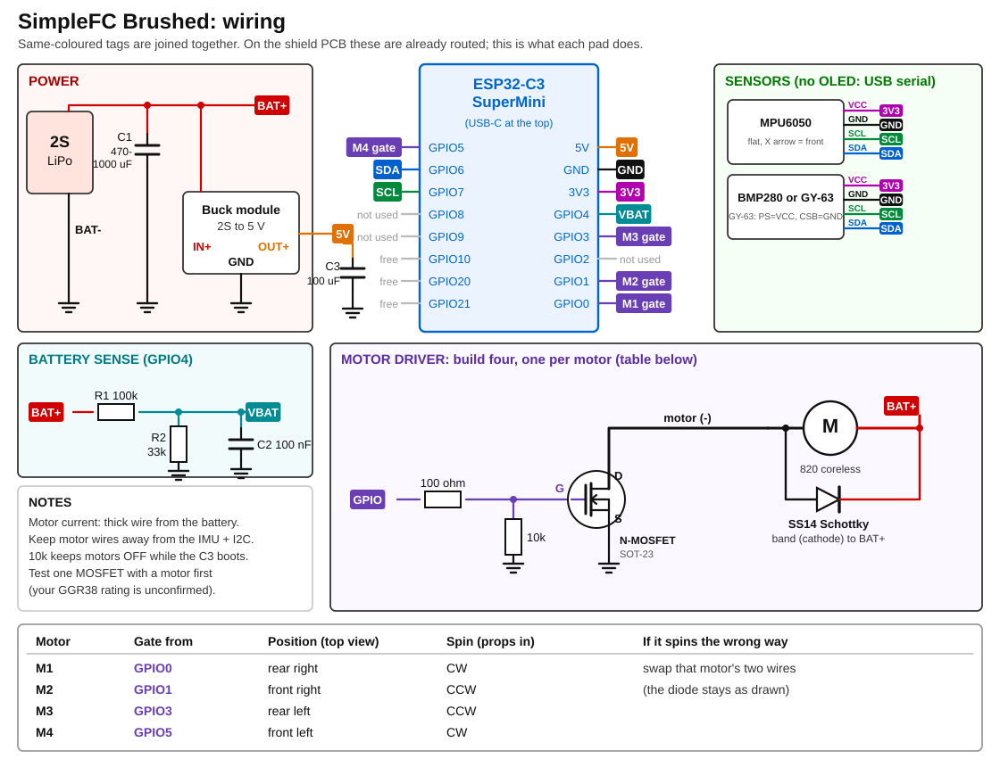

Shield PCB files are in [SimpleFC_Brushed/pcb](SimpleFC_Brushed/pcb). Parts placement:

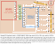

---

## SimpleTX – transmitter

**Setup guide:**

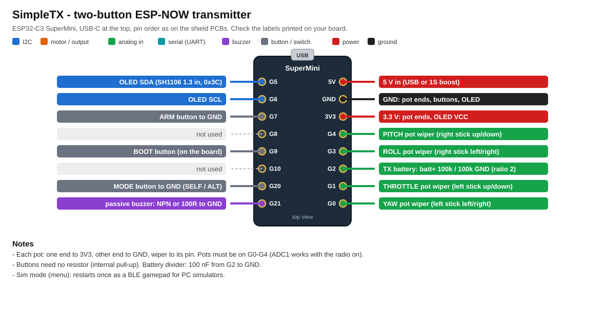

| Pin | Connects to |
|---|---|
| G1 | Throttle pot wiper (left stick, up/down) |
| G0 | Yaw pot wiper (left stick, left/right) |
| G4 | Pitch pot wiper (right stick, up/down) |
| G3 | Roll pot wiper (right stick, left/right) |
| G5 / G6 | OLED SDA / SCL (SH1106 1.3", 0x3C) |
| G7 | ARM button to GND |
| G20 | MODE button to GND (short press: SELF ↔ ALT) |
| G21 | Passive buzzer (through an NPN, or ~100R to GND) |
| G2 | TX battery: batt+ 100k → G2 → 100k → GND (ratio 2) |

Each pot has one end on 3V3, the other on GND, and the wiper on its pin. The buttons need no resistor.

---

## Transmitter2

**Setup guide:**

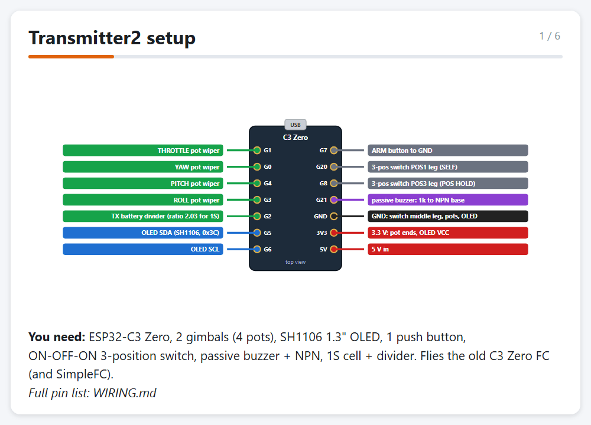

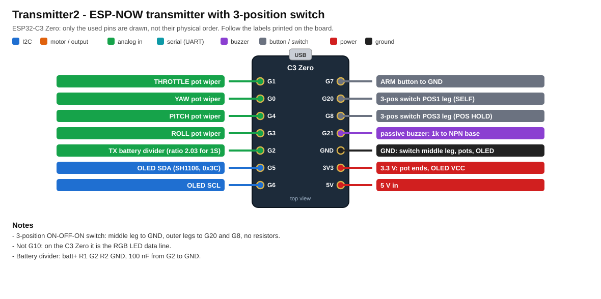

| Pin | Connects to |
|---|---|
| G1 / G3 / G4 / G0 | Throttle / Roll / Pitch / Yaw pot wipers |
| G5 / G6 | OLED SDA / SCL (SH1106, 0x3C) |
| G7 | ARM button to GND |
| G20 | 3-position switch, POS1 leg (SELF-LEVEL) |
| G8 | 3-position switch, POS3 leg (POS HOLD) |
| G21 | Passive buzzer: 1k → NPN base |
| G2 | TX battery divider |

The 3-position switch has its middle leg on GND and needs no resistors. Don't use G10: on the C3 Zero it drives the RGB LED.

---

## FlightController – old C3 Zero quad

**Setup guide:**

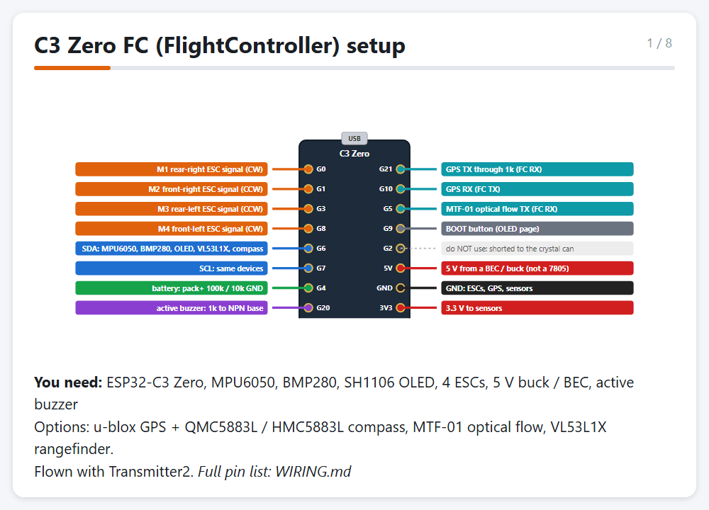

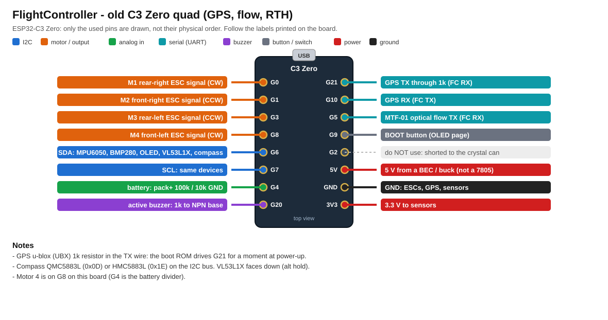

| Pin | Connects to |
|---|---|
| G0 / G1 / G3 / G8 | M1 RR / M2 FR / M3 RL / M4 FL ESC signals |
| G6 / G7 | I2C: MPU6050, BMP280, OLED, VL53L1X, compass (QMC5883L 0x0D / HMC5883L 0x1E) |
| G4 | Battery: pack+ 100k → G4 → 10k → GND |
| G20 | Active buzzer: 1k → NPN base |
| G21 ← | GPS TX through a 1k resistor |
| G10 → | GPS RX |
| G5 ← | MTF-01 optical flow TX |
| G9 | BOOT button (OLED page) |
| G2 | **Do not use**: shorted to the crystal can |

---

## ESP32_NodeMCU_FC

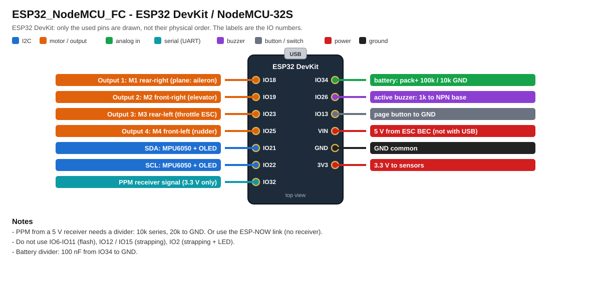

| Pin | Connects to |
|---|---|
| IO18 / IO19 / IO23 / IO25 | Outputs 1–4: M1 RR / M2 FR / M3 RL / M4 FL. Plane: aileron / elevator / throttle / rudder. |
| IO21 / IO22 | I2C SDA / SCL: MPU6050 + OLED |
| IO32 | PPM receiver input (3.3 V only: a 5 V receiver needs 10k in series and 20k to GND) |
| IO34 | Battery: pack+ 100k → IO34 → 10k → GND |
| IO26 | Active buzzer: 1k → NPN base |
| IO13 | Page button to GND |
| VIN | 5 V from an ESC BEC (not at the same time as USB) |

Pins to keep free:
- IO6–IO11: flash.
- IO12, IO15: boot strapping.
- IO2: strapping pin and on-board LED.
